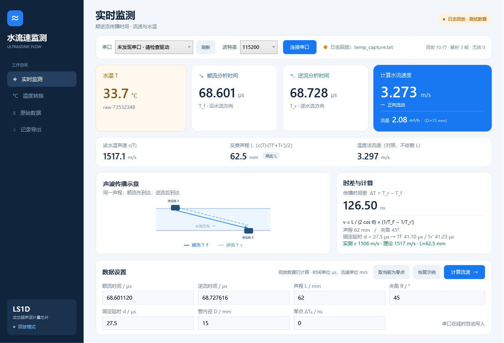
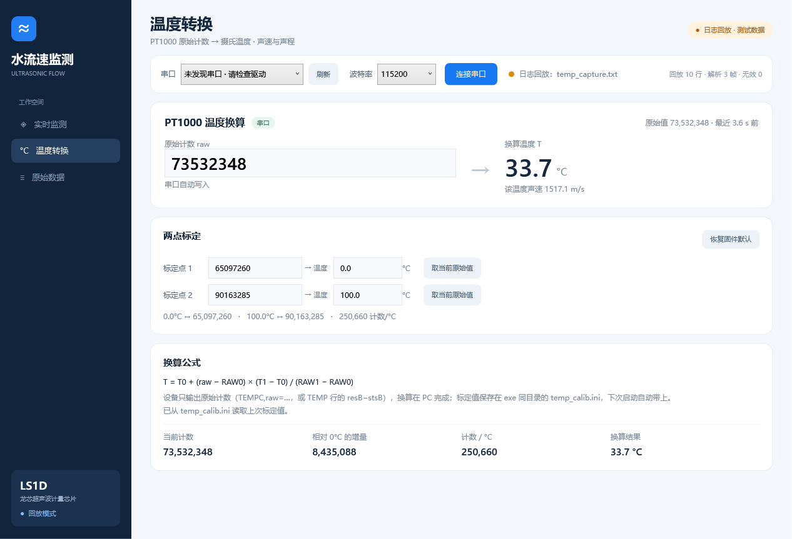
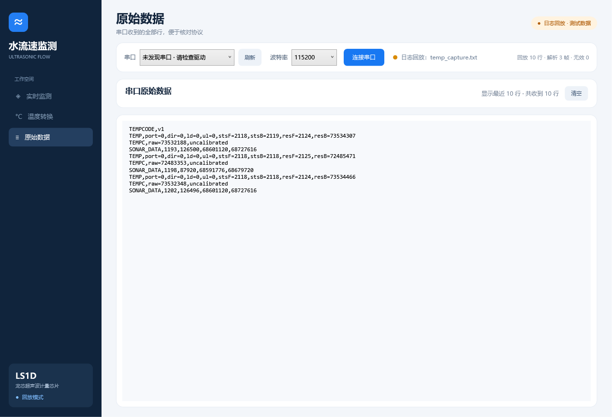
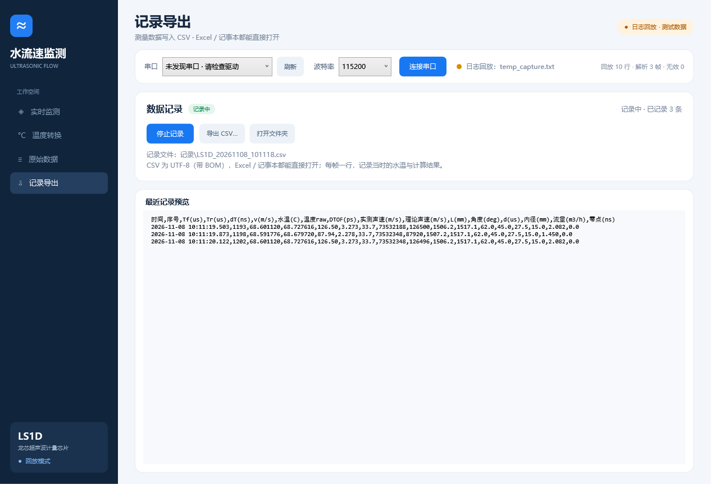

# LS1D 水流速展示终端（串口 + 温度 + 固定延时版）

在原来的 WaterFlowDemo 上接入了串口、PT1000 温度和新的流量公式。界面四页：**实时监测 / 温度转换 / 原始数据 / 记录导出**，一屏放得下；水温放在第一张卡片。



## 1. 运行

双击 `WaterFlowDemo.exe`（Windows 10/11 自带 .NET Framework 4.8，无需安装运行时）。

1. **先关掉 SSCOM**（串口独占，否则提示“串口被占用”）。
2. 选择设备对应的串口（`USB-SERIAL CH340`；WMI 受限时只显示 `COM3` / `COM6` 之类的端口名），波特率 `115200`。
3. 点“连接串口”。设备约 250 ms 上报一组声纳数据、约 1 s 上报一次温度。

也可以带参数启动：

```powershell
WaterFlowDemo.exe --port COM3 --baud 115200
WaterFlowDemo.exe --replay samples\temp_capture.txt --page 1
```

## 2. 三个页面

### 2.1 实时监测

- **第一张卡片是水温 T**，可直接点开“温度转换”页；当前 raw 显示在下面。
- 顺流 T_f、逆流 T_r、流速 v；v 用新公式（扣除固定延时 d）。
- 蓝色卡片下方显示**流量 Q（m³/h）**，按管内径 D 换算，并标注当前 D。
- 温度条：该水温声速 c(T)、反推声程 L（可点“用此 L”写回）、温度法流速（不依赖 L）。
- 时差与计算：ΔT、新公式、声程/夹角、**固定延时 d 与扣除后的 Tf′/Tr′**、实测声速对比。
- 数据设置：T_f、T_r、L、θ、**固定延时 d**、**管内径 D**、零点。

### 2.2 温度转换



- 原始计数 raw：串口自动写入，也可手动输入看换算。
- 换算温度 T：两点线性标定；默认用 26 号工程固件里的
  `0°C = 65097260`、`100°C = 90163285`。
- 换算明细：当前计数、相对 0°C 增量、计数/°C、换算结果。
- 公式：`T = T0 + (raw − RAW0) × (T1 − T0) / (RAW1 − RAW0)`
- 标定值保存在 exe 同目录的 `temp_calib.ini`。

> 问题跟踪表 #2 提到“raw 换算 30~33°C、实际水温更低”：现在默认标定就会显示约 **33.7°C**。
> 如果和温度计差几度，请在这一页用冰水/室温重新取两点，或改固件里的 `TEMP_RAW0/1`。

### 2.3 原始数据

串口收到的全部行（最近 200 行），便于核对 `SONAR_DATA`、`TEMP`、`TEMPC`。



### 2.4 记录导出



- **开始记录**：在 exe 同目录的 `记录\` 下新建 `LS1D_yyyyMMdd_HHmmss.csv`，每来一帧就追加一行。
- **导出 CSV…**：把当前会话缓存的测量记录一次性另存为 CSV（不开始记录也能导出）。
- **打开文件夹**：直接定位到记录文件。
- 编码 UTF-8 带 BOM，Excel 双击打开中文表头不乱码；记事本也能直接看。

CSV 列：`时间, 序号, Tf(us), Tr(us), dT(ns), v(m/s), 水温(C), 温度raw, DTOF(ps), 实测声速(m/s), 理论声速(m/s), L(mm), 角度(deg), d(us), 内径(mm), 流量(m3/h), 零点(ns)`。

> 记录里的水温取“该帧被处理时最新的一次温度”，温度约 1 s 更新一次，声纳约 250 ms 一帧，所以同一秒内几行会共用同一个水温。

## 3. 新的流量公式（问题跟踪表 #3）

```
Tf′ = Tf − d
Tr′ = Tr − d
v = L / (2·cosθ) · (1/Tf′ − 1/Tr′)
```

- **d = 27.5 µs**（电路 + 换能器固定延时，跟踪表暂取值）
- **L = 62 mm**（厂商标注的有效声程）
- 实测设备 T_f ≈ 68.60 µs、T_r ≈ 68.73 µs，扣除 d 后 Tf′ ≈ 41.10 µs、Tr′ ≈ 41.23 µs，实测声速约 1506 m/s，与 33.7°C 的理论声速 1517 m/s 相差 0.7%。

反推声程、实测声速、温度法流速也都改用 Tf′/Tr′：

```
L = c(T)·(Tf′ + Tr′)/2
c实测 = 2L/(Tf′ + Tr′)
v温度法 = c(T)·(Tr′ − Tf′)/(Tr′ + Tf′)/cosθ
```

如果固件里 d 或 L 改了，直接在“数据设置”里同步即可；“恢复示例”会回到 L=62、d=27.5 这一组。

### 3.1 流量（m³/h）

固件用管内径把流速换算成流量，段码屏显示的是 m³/h；app 现在也补上了同一套换算：

```
A = π·D²/4          （mm²）
Q = v · A · 0.0036  （m³/h，v 单位 m/s）
```

- **管内径 D / mm** 默认 15（与固件 `FLOW_PIPE_ID_MM` 一致），DN20 可改 19.4/20。
- 同一流速下内径影响很大：v=3.286 m/s 时，D=12 mm → 1.34 m³/h，D=15 mm → 2.09 m³/h，D=19.4 mm → 3.50 m³/h。
- 反流时 Q 为负，与 v 的符号一致。

## 4. 串口协议

声纳：

```
DTOF=883060 , Mtime = 842152

tof_f =67598040 , tof_b =68728800
SONAR_DATA,5156,842152,67598040,68728800
```

- `tof_f` / `tof_b`：ps，除以 1e6 得到 µs，作为公式里的原始 T_f / T_r。
- `SONAR_DATA`：`序号, dtof, tof_f, tof_b`，优先使用；两种格式按 150 ms 去重。

温度：

```
TEMP,port=0,dir=0,ld=0,ul=0,stsF=2118,stsB=2119,resF=2124,resB=73534307
TEMPC,raw=73532188,uncalibrated
```

- `TEMPC,raw=…` 用于换算；`uncalibrated` 表示固件端未标定，换算在 PC 完成。
- `TEMP` 行按 `resB − stsB`（dir=0）或 `resF − stsF`（dir=1）取计数。
- 也兼容 `TEMPC,raw=…,t=33.6`、`TEMP,25.3`、`TEMP_C=25.3`、`TEMP,timeout`、`TEMPCODE,v1`。

## 5. 无硬件时怎么验证

```powershell
WaterFlowDemo.exe --replay samples\temp_capture.txt --page 0
WaterFlowDemo.exe --selftest
WaterFlowDemo.exe --page 1 --screenshot
```

自检 39 项：解析（SONAR_DATA/旧格式/去重/非法帧/TEMP/TEMPC/SCAN）、公式（含 d=27.5 → 3.273 m/s、实测声速 1506.2 m/s）、流量（DN12/15/19.4 → 1.338/2.090/3.497 m³/h）、零点、逆向、两点标定（73532188 → 33.65°C）、0/20/25°C 声速、反推声程（扣 d → 62.00 mm）、温度法（扣 d）。

## 6. 命令行参数

| 参数 | 作用 |
|---|---|
| `--port COM3` `--baud 115200` | 启动即连接串口 |
| `--replay <文件>` | 回放日志（90 ms/行） |
| `--page 0/1/2` | 启动页：监测 / 温度 / 原始数据 |
| `--length 62` `--angle 45` `--delay 27.5` `--pipe 15` `--zero 0` | 预置声程、夹角、固定延时、管内径、零点 |
| `--raw 73532188` | 预置温度原始计数 |
| `--record` | 启动即开始记录 CSV |
| `--screenshot` | 截图到 preview.png 后退出 |
| `--selftest` | 自检 |

## 7. 和原版 demo 的差别

| 项 | 原版 | 现在 |
|---|---|---|
| 界面 | 单页、需滚动 | 三页导航、一屏放得下，水温第一张卡片 |
| 公式 | 未扣延时 | 扣除固定延时 d，L=62 |
| 数据 | 手工输入 | 串口实时 / 手工 / 日志回放 |
| 温度 | 无 | PT1000 原始计数 → °C，两点标定 |
| 目标框架 | net8.0-windows | net48（免装运行时） |

## 8. 自己编译

用 Visual Studio 2019/2022 打开 `WaterFlowDemo.csproj`，或：

```powershell
C:\Windows\Microsoft.NET\Framework\v4.0.30319\MSBuild.exe WaterFlowDemo.csproj /p:Configuration=Release
```

## 9. 常见问题

| 现象 | 处理 |
|---|---|
| 打开失败：串口被占用 | 关闭 SSCOM / 其它串口助手 |
| 端口名变了（COM3/COM6） | USB 重新枚举会改号，点“刷新”重选 |
| 流速显示“请检查输入” | 固定延时 d 不能大于 Tf/Tr，或 L 填了 0 |
| 温度一直“等待” | 固件没打印 `TEMPC`；确认 `TEMP_MEASURE_ENABLE=1` |
| 温度与温度计差几度 | 重新两点标定，或改固件 `TEMP_RAW0/1` |
| 流速乱跳 | 空管/气泡会使 ΔT 跳变；固件 `UserFlow.c` 有中值滤波和 ±200 ns 门限 |
| 流速符号反了 | 交换两只换能器接线 |
| app 的 m/s 和屏上 m³/h 对不上 | 两者不是同一个量；app 现在也显示 m³/h，差异来自管内径 D 填得不对（固件默认 15 mm） |

## 10. 文件清单

| 文件 | 用途 |
|---|---|
| `MainWindow.xaml` / `.xaml.cs` | 三页界面、串口/回放、温度与延时计算 |
| `Temperature.cs` | TEMP/TEMPC 解析、两点标定、声速、温度法、temp_calib.ini |
| `FlowMath.cs` | 新流速公式（扣除固定延时）、实测声速 |
| `SonarParser.cs` | SONAR_DATA / tof_f / tof_b 解析与去重 |
| `SerialLink.cs` / `SerialPorts.cs` | 串口读取、枚举 |
| `SelfTest.cs` | `--selftest` 自检 |
| `samples\sscom_capture.txt` / `temp_capture.txt` | 回放样例 |
| `preview.png` / `preview_temp.png` / `preview_raw.png` / `preview_record.png` | 四页截图 |
| `记录\` | 自动记录的 CSV 存放目录（运行时生成） |
| `WaterFlowDemo.exe` | 可直接运行的程序 |
